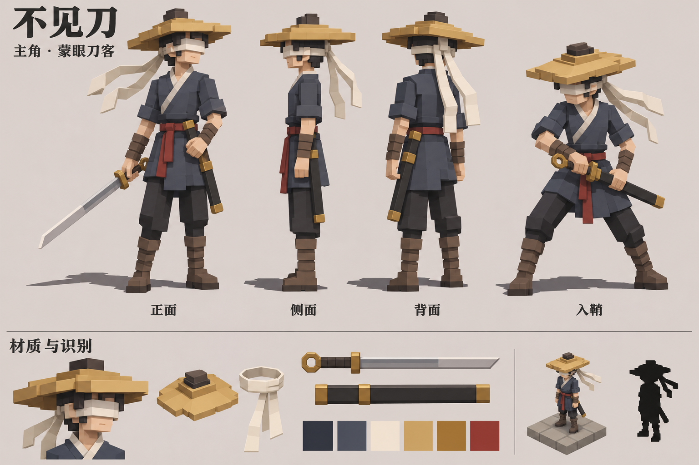
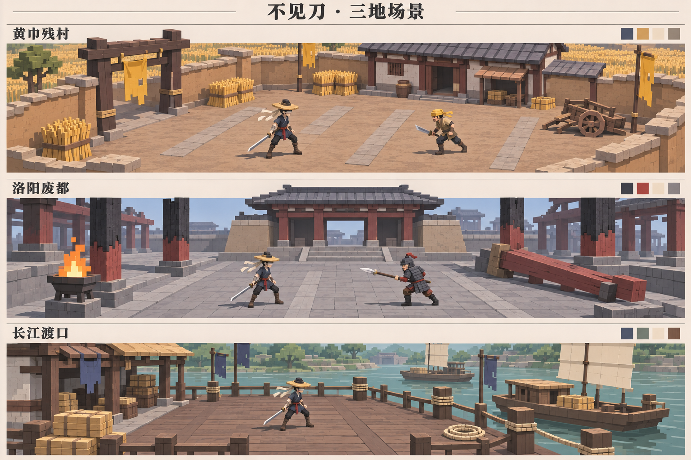
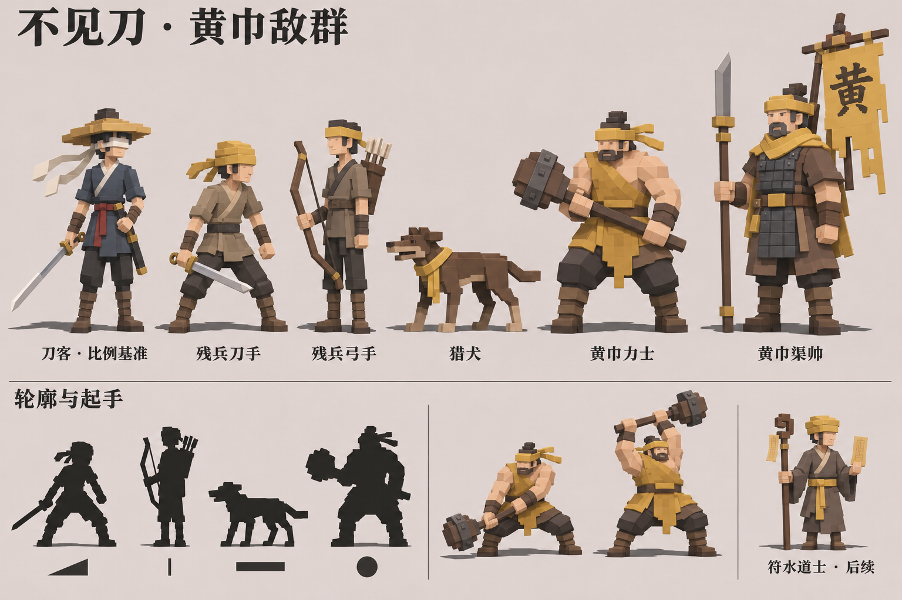
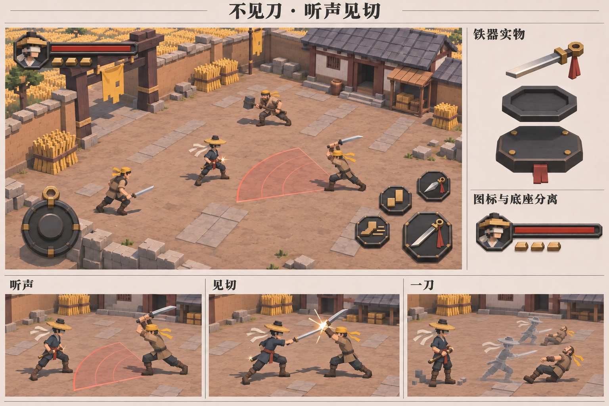

# 不见刀 · 美术设定 v0.1

> 2026-11-16 · 供美术评审与制作使用。用户本轮选择：**精致体素，接近未来游戏实机**。
>
> 本轮交付角色、环境、敌人、战斗与界面的美术设定；概念图用于约束制作方向，尚未接入运行中的游戏。尺寸、配色和表现预算中新增的数值均为建议值，需在当前镜头与手机上验证。

## 1. 核心方向

**一个白布蒙眼的刀客，立在汉末乱世的大块土木之间。画面平时安静，出刀时极准。**

主角靠听声辨位，战斗靠读招、见切、反击与「一刀」建立节奏。美术围绕这条循环组织：场景提供清楚的战场；敌人的轮廓和起手让人读懂；声纹解释危险；刀刃、布尾和短暂冲击表现速度。

三个候选方向中，选择精致体素作为制作方向。水墨方向适合另做宣传插画；写实方向会明显增加资产与动画工作量。正式游戏维持现有 three.js、大块体素与像素输出，以造型、光照和材质层次提升完成度。

**三个识别符号：宽斗笠、白布双尾、直身环首刀。三个材质关键词：粗布、旧铁、土木。**

### 已确定的边界

沿用项目 README、CLAUDE.md、GAME_PLAN.md、DESIGN.md 中最新的 act-13 反馈与本轮用户选择。文档之间不一致时，最新用户反馈优先：

- 三国乱世的原创蒙眼男刀客；默认斗笠造型，短衣下摆高于膝盖，头后保留两条长飘带。
- 身材瘦长、肩线放松、颈部可见，空手有自然弯肘；动作中的身体重心清楚。
- 大块、横平竖直的形体；不以逐格错位堆砌斜面，不撒随机碎点。体素基础单位沿用 7 厘米。
- UI 为有厚度、有投影的 3D 实物；技能图标与按钮底座分离，按钮上不放字。
- 不加全屏暗色遮罩，不用大面积泛光替代战斗信息；转换房间维持场景连续。
- 文案字体沿用长坂点宋 12。设定板里的印刷字体用于说明，不能直接当成游戏字体方案。
- 当前动作、战斗判定与成长系统不在本轮修改范围；图中后续敌人与场景不代表已经实现。

## 2. 主角：让人先认出「不见」，再认出「刀」

### 外轮廓与服装

斗笠提供横向的稳定轮廓，窄躯干和分开的双腿构成竖向动势，两条浅色布尾指示头部与运动方向。头、胸、胯、手脚要分得开，不把角色包成一整块袍子。

衣服为灰蓝交领短衣、暗裤、棕色护臂与绑腿，腰间仅留一条短暗红布。避免全身绑带、层层护肩和大面积铠甲。衣服的层次依靠领口、袖口、腰带和下摆四处结构建立。

白蒙眼布必须盖住双眼，斗笠下仍能看见它。面部不以蓝眼、发光眼或演员脸作为卖点。胡须、伤痕等细节暂不设为识别必需项，避免缩小后变成噪点。

### 刀、刀鞘与动作

直身单刃刀、明确可辨的环首、克制的铜色装具、黑色刀鞘。刀鞘固定在左腰，右手抽刀；建模时按这套持握校验，不能照生成图逐像素推算结构。

待机：双脚踩实，刀尖自然低垂，空手微弯。入鞘：左手控制鞘口、右手就柄，肩不耸，重心下沉。出刀：胸胯与前脚共同推进。收刀：动作利落，布尾稍后跟上，停顿中仍看得清双腿与刀。

### 体素制作建议

- 以现有瘦版骨架为比例锚点，不为贴合概念图而先改碰撞体。概念图的头身比例与局部斜面是视觉意向。
- 7 厘米为基础单元，主要构件保持整块；刀刃、布、甲片等薄片由独立薄构件表达，允许整体旋转。
- 主形先由躯干、腿、帽檐、手臂确定，再补领口、护臂、刀鞘；小于实机可读尺寸的扣件不单独堆格。
- 蒙眼布尾用少量关节控制宽条，避免变成几十段细链。布尾不能在俯视角里遮住敌人起手。
- 按默认镜头输出正面、背面、跑动、入鞘四种实机缩略图；再看大图细节。

## 3. 统一配色与材质

| 用途 | 建议色 | 使用原则 |
|---|---|---|
| 黑铁与最深结构 | #272E38 | 按钮底座、刀鞘、衣服深面；保留结构层次 |
| 主角灰蓝布 | #3C4654 | 主角衣服主色，避免铺满同色背景 |
| 蒙眼布与浅色提示 | #EEE8DA | 主角识别与瞬时提示；持续发光要克制 |
| 斗笠麦秆 | #C9A457 | 主角头部识别，与灰蓝衣形成冷暖关系 |
| 暗红 | #B8302A | 腰布、血量；不作为所有装饰的万能强调色 |
| 旧铜 | #B8893A | 环首、铆钉、UI 图标；不做满屏亮金 |
| 土石中间色 | #8A8070 | 战斗地面基底，饱和度与纹理密度均低于角色 |

单件主要材质控制在 2～3 档色阶。粗布靠大平面折转，铁靠窄亮边和厚度，木靠接缝和梁柱结构，土墙靠块面缺口与底部体积。不要用逐像素磨损、随机草点和密集砖缝填满画面。

环境亮度维持中间调，敌人脚下有接触影。主角跳起时，地面落点仍清楚；不以额外黑色滤镜制造「高级感」。

以上为风格化汉末题材设计，具有玩法上的夸张，不作为考古复原或统一历史年代的证据。

## 4. 三个地域：从土、到石、到水

| 地域 | 一眼认出的形体 | 地面与光色 | 边缘叙事道具 |
|---|---|---|---|
| 黄巾残村 | 夯土墙、低矮灰瓦屋、粗木门框、成束麦秆 | 大块灰褐土面，暖而清楚的天光 | 倾斜牛车、黄布、粮袋、破篱笆 |
| 洛阳废都 | 高台残基、断朱柱、横倒焦梁、宽大宫门 | 大块冷灰石面，局部余火提供暖色 | 断瓦、倒下的兵器架、烧黑门扇 |
| 长江渡口 | 宽船板、泊船、桅杆、方帆、芦苇束 | 低饱和青绿水面与深木甲板 | 缆桩、木箱、渔具、卷起的船帆 |

### 镜头与布置

实机沿用当前偏俯视的三分之四镜头。三地板为了展示建筑结构，视线低于最终战斗镜头；相机以战斗与 UI 板及现有参数为准，不能直接按场景板的透视搭关卡。角色的活动区域、入口、出口和边缘遮挡必须先确定，再放建筑。

建议把约六成画幅留给可读的战斗区域，最密的环境叙事放在后沿和两侧。中央不散落无法判断碰撞的小石块、草点和瓦片。可碰撞物要有清楚的大体积，可跨越或只装饰的物件应在尺寸和接地方式上有所区分。

前景墙、树冠和屋顶进入镜头时，采用裁短或局部隐藏的方案，保证主角与危险提示可见。避免为遮挡问题给整个战场蒙黑。

三地共用地面分块、木梁、木箱、火盆等基础资产，靠建筑比例、材质比重和地貌建立差别。优先用结构改变题材识别，不能只把旧日式资产重新染色。

### 建议环境模块

- **共用**：大地面块、直梁、立柱、台阶、门框、木箱、火盆、边缘围挡。
- **残村**：土墙直段／转角／缺口、低屋顶、粮垛、牛车、麦秆束、黄布旗。
- **废都**：宽台基、朱柱／断柱、焦梁、宫门、残墙、成组断瓦。
- **渡口**：宽窄甲板、转角、桩、舷侧、简船身、帆架、芦苇束。

尺寸先按当前房间、可通行宽度与跳跃距离校核，不在美术阶段另定一套地图尺度。

## 5. 敌人：轮廓就是招式说明

第一轮只重做现有四种战斗职责的外观。黄色头布表达阵营，不要求每个敌人都全身黄；装备、身形与动作负责区分类型。

| 美术身份 | 对应当前职责 | 轮廓重点 | 起手时必须看见 |
|---|---|---|---|
| 残兵刀手 | 山贼／近身扇形斩 | 中等瘦身、单刀、偏一侧的手臂 | 持刀臂先抬起或横收，身体留出出刀方向 |
| 残兵弓手 | 远程弓手 | 窄长身体、完整弓形、背上箭囊 | 拉弓与停住瞄准，箭线不藏在布景里 |
| 猎犬 | 直线扑咬 | 低矮横向身躯、长口鼻、四足 | 压低前身、后腿蓄力，扑出前有明确停顿 |
| 黄巾力士 | 现有重击头目职责 | 宽躯干、粗前臂、长柄重物 | 高举武器与扎稳双腿，重击落点清楚 |

猎犬的阵营布结只是概念示意，实作优先用深色皮项圈与训练痕迹，避免过于宠物化。这里的职责映射不要求立刻改代码中的 ID、敌人参数或招式。力士先接现有头目的动作职责；是否改判定或武器由后续设计单独决定。

**后续方案**：黄巾渠帅作为地域首领、符水道士作为远程术士，均为概念预留。渠帅用立起的黄布令旗和胸前旧铁甲建立权威感；道士用狭长轮廓、木杖与宽符纸区别于弓手。不能把两者的概念图写成已完成敌人。

精英优先改变一处大轮廓或持械方式；不要只加发光描边，也不要靠头顶颜色判断强弱。倒地、硬直和霸体状态继续以身体反应及简洁提示共同表达。

## 6. 战斗信息：危险在地上，时机在刀鞘，结果在敌人身上

### 信息优先级

1. 即将命中的危险范围、箭与敌人起手。
2. 主角位置、脚下落点、入鞘与见切时机。
3. 命中、硬直、完美闪避与反击结果。
4. 常驻数值与场景装饰。

高优先级信息出现时，减少同一区域的装饰粒子与低价值特效。不能依靠加大所有亮度解决信息竞争。

### 预警与反馈

| 事件 | 形状／动作 | 建议色与节奏 |
|---|---|---|
| 近身劈砍 | 与判定一致的扇形边界、内部少量声纹 | 低填充的朱红，临近命中时边界变明确 |
| 直线扑咬 | 窄长条与前进方向，能跳过时保留横纹 | 与其他危险同一色系，靠形状区分 |
| 重击砸地 | 圆形边界与向落点收拢的少量声纹 | 不以更多粒子替代范围边界 |
| 弓箭 | 明确瞄准线、单支可见箭体 | 远近与命中时机靠运动和声音共同表达 |
| 入鞘蓄力 | 脚下小范围进度与斩钮状态同步 | 旧铜转暖金；不画成巨大魔法阵 |
| 可以见切 | 刀鞘口短闪、脚下小环与斩钮同步一拍 | 暖白脉冲；提示窗口沿用现有判定 |
| 见切成功 | 敌人被打断、刀刃短促亮线、接触点爆点 | 一次短闪与顿帧，不持续泛光 |
| 完美闪避 | 原位置短残影、主角迅速脱离 | 冷青白，轮廓少且短 |
| 反击待发 | 刀尖或刀鞘小亮点、斩钮抬起 | 暖金，仅照亮重要局部 |
| 柳叶镖 | 独立可辨的柳叶形镖身、短红缨、快而直的轨迹 | 钢白刃面，少量短拖尾，不做发光子弹或日式手里剑 |
| 刃风 | 一片薄而清楚的月牙刀光，贴腰高直飞 | 白芯淡青边，少量残片，避免圆球与长子弹拖线 |
| 绝·一刀 | 主角化烟、目标旁短现分身、原地现身收刀、统一受击 | 分身各保留可辨轮廓，淡烟局限在事件附近；不蒙黑战场 |

声纹的覆盖范围必须来自真实判定，不能为好看画得更大。红绿辨识困难时，仍应能通过扇形、长条、圆环、横纹和起手姿势分辨危险。

普通斩击用短、薄、方向明确的刀光；连刺用直线；重劈强调落点；一刀强调分身出现、斩中与主角收刀的节奏。只在高光事件短暂提高特效强度，平时留出安静的空间。概念图的多状态排布用于解释状态，不能理解成它们需要同时出现。

## 7. 铁器 UI：像兵器零件，也要像清楚的控件

材质组合为黑铁底盘、旧铜铆钉、独立浅铜色浮雕图标，斩钮留一小段暗红布穗。主要厚度来自底盘、凹槽、外缘三层，避免每一层都镶金。

### 四颗按钮

- **斩**：独立的环首刀模型，最大、最容易触达。按下压低；入鞘时底座状态变化；见切时机与刀鞘同步。
- **冲**：脚步与向后风线的立体组合；轮廓以横向动势为主。
- **跳**：两层上升踏板或大块升起形体，不能用逐格爬升的细碎斜线凑图标。
- **技**：按 act-13 最新反馈改为柳叶镖：独立钢白镖身、旧铜小环与一小段暗红缨。不得沿用三人影图标，也不画成日式多角手里剑；以后换技只换独立图标，底座结构通用。
- **绝**：维持已有 QTE 机制，在斩钮周围临时收环，不增加第五颗常驻按钮。

建议在 1280×720 参考画幅中试斩钮约 112～128 像素、辅钮约 80～96 像素的尺寸范围，再按设备密度、触控面积与舒适度调整。触控热区不必等于可见铁盘轮廓，手机上要实测拇指遮挡与误触。

冷却用底座分区逐步恢复，图标降低并收暗；就绪仅一次短促抬升；常态不持续旋转跳跃。装饰铜钉不能看起来像进度格。

act-13 文档把影分身效果挪给「一刀」：主角化烟，目标旁短现分身出刀，主角在原地现身收刀。这个分配是当前实现方向，用户此前只同意保留并另用分身效果，未单独指定归属；最终效果仍需评审。美术不擅自增加常驻分身或第五键。

### 血量、杀意与摇杆

血量为浅铁槽中的连续暗红带，配克制的拖尾与少量刻度，主角头像保留斗笠和白蒙眼布。数字可作为补充，不能要求玩家先读数字才知道剩余血量。

三格杀意维持 HUD 的清楚读数。GAME_PLAN.md 中的腰铃作为后续身上提示预留，不在本轮同时新增腰铃和另一套铜锭含义，以免产生两套独立资源的错觉。

摇杆为铁环与铜环头，保持左下限定触发区域，按下后底座不随手指漂移。其亮度与细节密度低于右侧斩钮。

秘传选择仍可使用有厚度的木简、甲片或器物承载内容，但排版需满足可读性。与游戏有关的解释文字由后续文案流程确认，设定板的说明标签不进入按钮。

## 8. 制作顺序与验收

### 建议先做一个房间

1. **主角定稿**：同骨架完成斗笠、蒙眼布、短衣、刀与鞘，在现有镜头验证跑、跳、入鞘与五段连斩。
2. **残村最小场景**：一块开放地面、土墙、门框、低屋顶、两组边缘大块道具。
3. **四种现有敌人换装**：先看纯黑轮廓，再看起手与战场尺寸；保持当前职责可比对。
4. **声纹与反馈**：分别验证普攻、扑咬、弓箭、重击、见切、闪避、一刀，避免一次叠满全部特效。
5. **铁器 UI 精修**：先按钮图标与血槽，再装饰和动态。
6. 残村实机效果确认后，再扩展废都、渡口、渠帅与道士。

### 验收清单

- 默认相机下，斗笠、白布与直刀清楚；缩小画面仍能找出主角。
- 四种当前敌人不看头顶名称和颜色，也能靠轮廓及起手区分。
- 有地面危险时，脚、落点与危险边界均可见；装饰物不会造成假障碍。
- 俯视、背面、空中和收刀时都没有耸肩、肩缝、僵直空手或飘地。
- 材质以大块结构和 2～3 档色阶表达，没有随机碎点、逐格阶梯斜纹和过亮塑料感。
- 四颗技能钮无文字、图标与底座分离，血量能直接读懂；QTE 不依赖新增按钮。
- 白天、废墟冷光与水面背景下，都能读清预警；无全屏暗色遮罩。
- 以手机 60fps、全帧 draw call ≤150 为目标预算。项目文档记录现状约170，需以实际设备重新测量；本轮未运行性能测试，也未承诺达到预算。
- 静态环境合并、重复件实例化、角色共享材质与减少 UI 小网格应优先于加后处理。美术精致度先来自造型、构图与时机。

## 9. 文件与交付状态

| 文件 | 内容 |
|---|---|
| 01-hero.png | 主角多视图、入鞘姿态、兵器与材质识别 |
| 02-environments.png | 黄巾残村、洛阳废都、长江渡口 |
| 03-enemies.png | 当前四种敌人职责的造型方向，以及后续首领／道士预留 |
| 04-combat-ui.png | 实机目标、战斗提示与铁器 UI 方向 |
| ART_DIRECTION.md | 本文：方向、规则、制作边界与验收标准 |

图像由内置图像生成工具制作，为二维概念设定，并非已建模、已绑定、已导入的 3D 资产。图中局部结构、文字与精确尺度须以本文及后续实机评审为准。原始生成缓存保留在工具默认目录；项目只接收本轮正式交付物。

**本轮未改游戏代码、未替换现有资源、未构建试玩、未提交或推送 Git。** 读图依据为项目现有截图与源文件；后续代码接入需在美术方向确认后进行。

## 10. 剧情立绘与对白（2026-11-17 参考方向）

用户明确指定的参考为老《三国志》街机、《吞食天地》和《三国战纪》；适用范围是**人物立绘与剧情对话层**。世界场景继续使用项目现有体素表现。

- 人物立绘采用原创的街机手绘像素风：鲜明的眉眼与表情、粗犷的轮廓、有限调色板、成片的硬边色阶与有意识的像素簇，整倍数清晰放大。面部、衣褶和甲片都需要按这套语言重新绘制。
- 立绘保留角色已有身份与服装识别。渠帅仍为黄巾、浓须、灰蓝札甲与长戟；蒙眼刀客仍为斗笠、白蒙眼布双尾、短衣与环首刀。
- 对话采用清楚的点阵字、金色姓名、米白正文、简洁深色底与细金红像素边。控制边框面积和装饰量，保持场景中的人物可见。
- 复古感来自造型、用色和像素组织；不以扫描线、噪点、模糊或全屏暗罩作为主要手段。
- 当前评审图：[街机立绘对白模拟](09-dialogue-arcade.png)。该图为风格候选，尚未接入游戏；后续根据用户评审再推广到其他角色。
